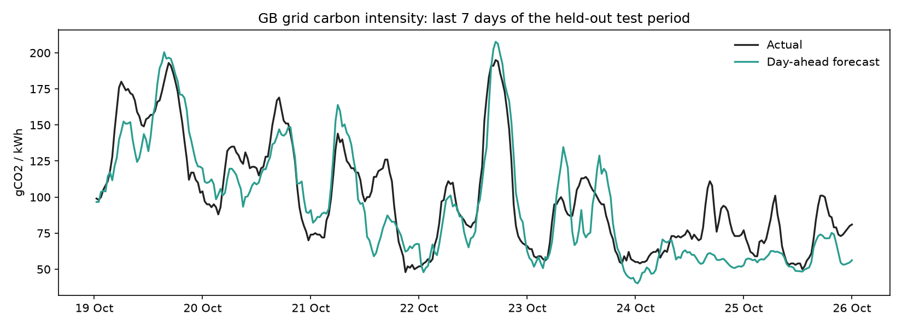
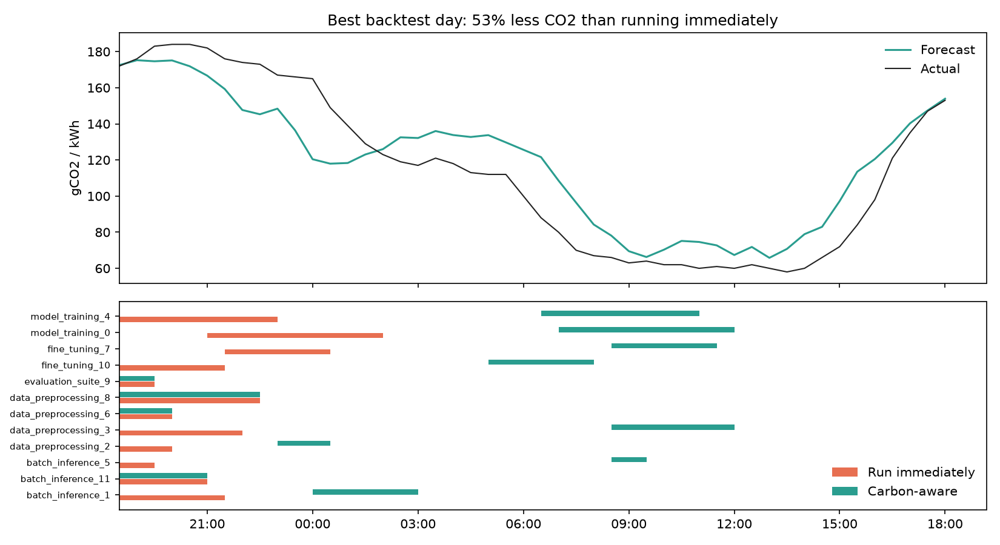

# Carbon-Aware AI Workload Scheduler

The same GPU job can emit **twice as much CO2** depending on *when* it runs. On the
GB grid, carbon intensity swings between ~50 and ~200 gCO2/kWh within a day as wind,
solar and gas generation change.

This project forecasts the next 24 hours of grid carbon intensity with XGBoost and
schedules non-urgent AI workloads (training, fine-tuning, batch inference, evals) into
the cleanest windows, without missing any deadline or exceeding the cluster's power budget.

**Results on 90 held-out days of real GB grid data:**

| | |
|---|---|
| Forecast accuracy (30 min - 24 h ahead) | **R² 0.77**, MAE 19 gCO2/kWh (naive baselines: MAE 41) |
| Forecast accuracy 1 h ahead | R² 0.89 |
| Emissions reduction vs running jobs immediately | **10.8% overall**, up to 30% on 1 in 10 days, best day 53% |
| Share of the theoretical maximum saving captured | 86% (a perfect forecast would save 12.5%) |
| Deadlines missed | 0 |



## Run it

```bash
python3.11 -m venv .venv && source .venv/bin/activate
pip install -r requirements.txt
python run.py
```

`python run.py` downloads ~2 years of data, trains and evaluates the model, backtests the
scheduler and schedules the jobs in `jobs.json` for the next 24 hours (~10 minutes on a
laptop). No API keys needed. On macOS, XGBoost needs OpenMP once: `brew install libomp`.

Individual steps:

```bash
python run.py fetch       # download / update grid + weather data (incremental)
python run.py train       # train + evaluate the forecaster
python run.py backtest    # emissions savings on the held-out period
python run.py schedule    # live 24 h forecast + schedule for jobs.json
pytest                    # unit tests (leakage, deadlines, capacity)
```

Example output of `python run.py schedule`:

```text
Cleanest slot   : 23:30 UTC (61 g/kWh)   dirtiest: 07:00 UTC (129 g/kWh)

                    job  urgent  power_kw    start_utc      end_utc deadline_utc  forecast_kg_co2
  hotfix_model_redeploy    True       2.0 26 Oct 03:00 26 Oct 03:30 26 Oct 05:00             0.06
  regression_eval_suite   False       3.0 26 Oct 03:00 26 Oct 04:00 26 Oct 13:00             0.19
nightly_batch_inference   False       5.0 26 Oct 13:30 26 Oct 15:30 26 Oct 19:00             0.68
        llm_finetune_v3   False       9.5 26 Oct 20:00 26 Oct 23:00 26 Oct 23:00             1.88
  vision_model_training   False      14.0 26 Oct 21:00 27 Oct 03:00 27 Oct 03:00             5.26

Predicted emissions: 8.7 kg CO2 vs 12.4 kg if run immediately (30.0% lower)
```

To schedule your own jobs, edit `jobs.json` (duration, power draw, deadline, urgent flag).

## How it works

```text
 National Grid ESO API ──┐                                   ┌──> jobs.json
 (half-hourly gCO2/kWh)  ├──> features ──> XGBoost ──> 24 h ──┤
 Open-Meteo day-ahead  ──┘    (as of t0)   forecast   curve  └──> scheduler ──> schedule.csv
 weather forecasts                                                (deadlines + kW budget)
```

**Data** (`carbon_scheduler/data.py`): actual GB carbon intensity from the National Grid ESO
Carbon Intensity API, and weather forecasts for 7 UK locations (5 wind regions, 2 demand/solar
regions) from Open-Meteo. Historical weather comes from Open-Meteo's *previous runs* archive:
the forecast that was actually issued the day before, not the observed weather, so training
never sees information that wouldn't have been available at the time. Both are cached and
updated incrementally.

**Forecaster** (`features.py`, `model.py`): each training row is a forecast issued at time t0
for a slot 30 min to 24 h later. Features are only things known at t0: current and recent
intensity, intensity at the same slot yesterday and last week, the calendar, the day-ahead
wind / solar / temperature forecast for the target slot and how much it changes from now.
XGBoost predicts the *change* from the current intensity rather than the absolute level, which
keeps short-range forecasts anchored to what is known now (tree models can't extrapolate
"stay near the current value" on their own). The most important features are forecast solar,
the change in forecast wind power, and the current intensity.

**Scheduler** (`scheduler.py`): urgent jobs start immediately. Flexible jobs are placed,
least-slack first, in the contiguous window before their deadline with the lowest forecast
intensity, while the cluster's total power draw never exceeds its budget.

**Backtest** (`backtest.py`): for each of the 89 held-out days, a batch of 12 realistic AI
jobs (20% urgent) arrives at a random time. Three schedules are compared: run immediately,
carbon-aware (using the model's forecast) and oracle (using the real future). All three are
scored with the **actual** intensity, so forecast errors count against the scheduler.

## Evaluation and honesty notes

- The last 90 days are held out completely; no training row has a target inside that period.
- Cross-validation uses `TimeSeriesSplit` with a one-day gap (always train on the past).
  CV R² is 0.71 ± 0.12; the first fold is weakest (0.48) because it trains on only a few
  months, which is expected for a seasonal series.
- `tests/test_features.py` checks that changing any grid value after the issue time does
  not change a single feature.
- Accuracy drops with lead time (R² 0.89 at 1 h, 0.74 at 24 h): day-ahead wind forecasts
  are the main source of error.
- Savings depend on how much the grid varies: calm, gas-heavy days offer little to shift
  into; windy or sunny days offer a lot.

## Project structure

```text
carbon_scheduler/
  config.py      all settings (locations, model params, capacity) in one place
  data.py        download + cache grid and weather data
  features.py    issue-time feature engineering (no future leakage)
  model.py       XGBoost forecaster, time-series CV, held-out evaluation
  scheduler.py   deadline- and capacity-aware carbon scheduling
  backtest.py    emissions simulation on held-out days
  plots.py       charts
  pipeline.py    CLI: fetch / train / backtest / schedule / all
tests/           unit tests
jobs.json        example job queue
run.py           one-command entry point
```

## Possible extensions

- Separate models for short and long lead times (very short horizons can still do better).
- Regional intensity (the API has 14 GB regions) to also choose *where* jobs run.
- Let long training jobs pause and resume to use several clean windows.
- Run `python run.py schedule` from cron every 30 minutes to keep the schedule updated.


